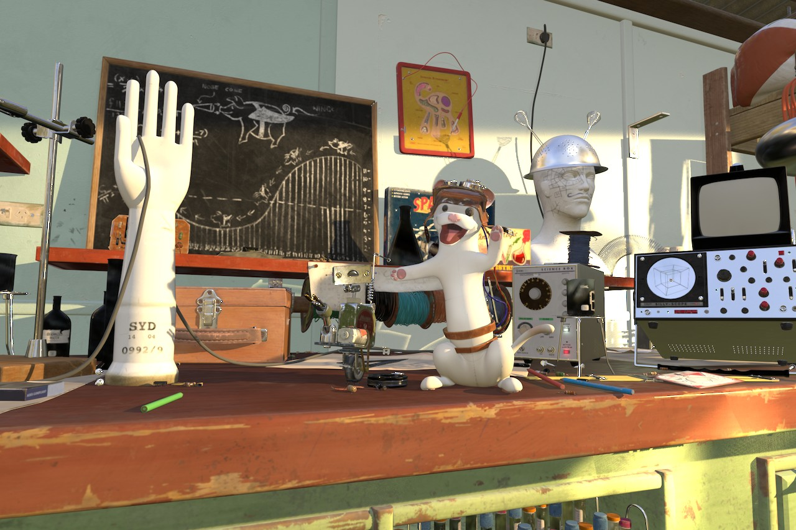
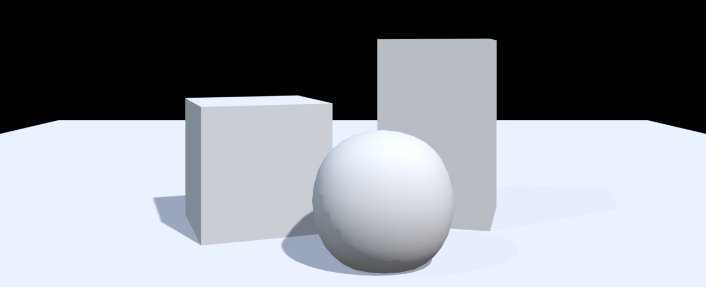

# Pika

Pika is a real-time renderer for animation, in the style of Blender's EEVEE. It runs inside any Hydra host, such as usdview or Houdini, and aims to play cached shots back at their final look: 1080p at 24 fps on a 16 GB GPU.



*ALab, frame 1030 of its render camera, drawn by Pika. Netflix Animation Studios ALab Copyright 2025 Netflix, Inc. All rights reserved.*

Pika is written in Rust and draws with Vulkan through [ash](https://crates.io/crates/ash). Its shaders are written in [Slang](https://shader-slang.org). A small C++ Hydra render delegate copies the scene in. Materials come from the upstream MaterialX shader generator, so OpenPBR, Standard Surface, UsdPreviewSurface and any other surface in the host's MaterialX libraries draw as those libraries define them.

## Status

This is a very early toy project. Currently it does the following:
- **Meshes** with subdivision, instancing, holes, normals, visibility, purpose and GeomSubsets. Pika renders color, depth and normal AOVs.
- **Materials** from each mesh's MaterialX surface.
- **Textures**, baked once into a cache, with UDIM sets kept as one array. When textures don't fit in GPU memory, the ones the camera needs least are lowered first.
- **Lights**: distant, sphere, rect, disk and cylinder lights, the host's camera light, and light linking.
- **Soft shadows** from every light, following shadow links. While the view is still, each frame adds one shadow sample until 64 have been drawn. Shadows are cached between frames and redrawn only where a light or a moving mesh changes them.
- **Dome lights**: the sky lights matte surfaces, and its reflection is blurred by roughness. A bright sun in the sky is lifted out into a distant light that casts shadows. The sky shows behind the scene unless the host hides dome lights from the camera, as usdview's "Show Dome Light Textures" and usdrecord's default do.



## Requirements

[Nix](https://nixos.org) users can run `nix develop` to get every tool below except the GPU driver. Without Nix, you need:

| For | You need | Notes |
| --- | --- | --- |
| Build | Rust and a C linker | No Vulkan SDK needed. libvulkan is loaded at run time. |
| Run | The Vulkan loader and a Vulkan 1.3 GPU driver | Tested with NVIDIA driver 595.71 on an RTX 4070 Ti SUPER. |
| Run | [`slangc`](https://github.com/shader-slang/slang/releases) on `PATH` | Tested with 2026.21. Run Pika from the checkout, since it reads `shaders/` and the bake tools from there. |
| Validate | The Vulkan validation layer | Optional. Pika turns it on when `VK_ADD_LAYER_PATH` names it. |
| Delegate | OpenUSD with Python, OpenSubdiv, `g++` and `make` | Tested with OpenUSD 26.11 and g++ 16.2. |
| Bake | MaterialX 1.39.5 or newer, OpenImageIO, `g++`, `make` and [`ispc`](https://github.com/ispc/ispc/releases) | 1.39.5 is the first MaterialX with a Slang generator. Tested with OpenImageIO 3.1 and ispc 1.32. `MATERIALX` names the directory holding MaterialX's `libraries/`. |
| Check | A display or `Xvfb`, plus `curl` and `unzip` to fetch ALab | `hydra/check.sh` starts its own Xvfb. |

The bake tools are two programs the renderer runs: `generate` turns material documents into shaders, and `texture` bakes textures. Build them before rendering, and rebuild them if MaterialX or the checkout moves, since they compile in both paths. Textures are converted through the OCIO config named in `OCIO`, or OpenImageIO's default.

Generated shaders and baked textures are cached in `$XDG_CACHE_HOME/pika`, or in `PIKA_CACHE` if set. ALab's fill 145 GB.

## Build and check

```sh
cargo fmt --check
cargo clippy --locked --all-targets -- -D warnings
cargo test --locked
cargo run --locked --release   # device check, needs a GPU
make -C hydra                  # the delegate, into target/hydra
make -C bake                   # the bake tools, into target/bake
bake/check.sh
hydra/check.sh                 # renders, needs a GPU
```

CI runs the three cargo commands on a runner without a GPU. `hydra/check.sh` renders every scene in `hydra/images/` and compares it with a reference ray cast from the USD. Each check also runs controls, deliberately wrong references that must fail.

## Try it

Point USD at the delegate and open a scene:

```sh
export PXR_PLUGINPATH_NAME=$PWD/target/hydra
usdview --renderer Pika hydra/scenes/look/room.usda
```

Three render settings tune Pika. usdview lists them in its Hydra settings, and husk reads them from the stage's render settings:

| Setting | What it does |
| --- | --- |
| `pika:textureCap` | Caps every texture to this many texels a side. 0, the default, means no cap. |
| `pika:shadowPool` | The shadow cache's size in MB, 256 by default, with as much again for moving meshes. A view that needs more draws its farthest shadows coarser, with a warning. |
| `pika:sunThreshold` | Parts of a dome light's sky brighter than this are lifted out as a sun that casts shadows. 10 by default, and 0 means no sun. |

For a production-sized scene, `corpus/fetch.sh` downloads [ALab](https://dpel.aswf.io/alab/) 2.3.0 (108 GB) into `corpus/`, which git ignores. `hydra/gate.sh` times its playback. Set `PIKA_STATS` to a file to record any run's timings, and summarise them with `hydra/stats.py`. Each script's header says what it does and how to run it.

## Layout

| Path | What it holds |
| --- | --- |
| `src/` | The renderer: the scene store, materials, textures, lights, shadows and the frame |
| `shaders/` | Slang shaders |
| `hydra/` | The C++ render delegate, its checks and test scenes |
| `bake/` | The material and texture tools, and their check |
| `corpus/` | The ALab fetch script |
| `docs/` | The images in this README |

`NOTICE` lists the third-party code Pika ships and its licences.
